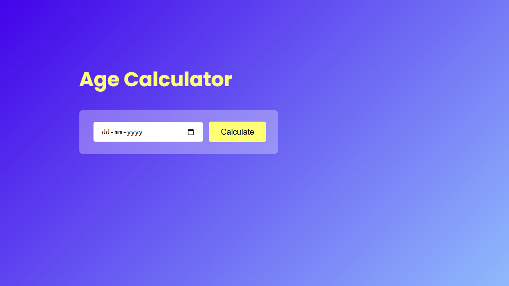

# Age Calculator

An age calculator I built with HTML, CSS and JavaScript while learning how dates work in JavaScript.

Pick your date of birth and it tells you your exact age in years, months and days.

## Run it locally

Open `index.html` in a browser.
